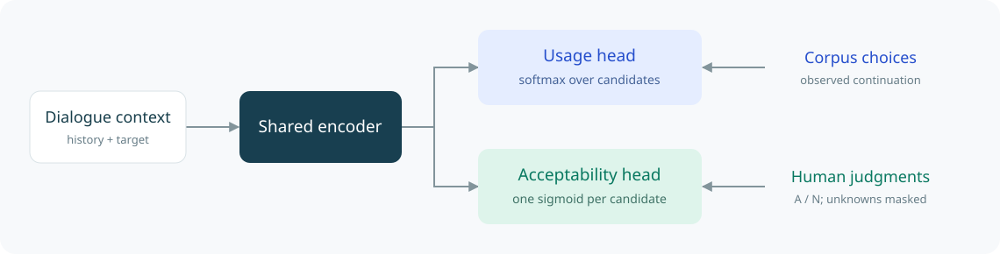

<p align="center"></p>

<p align="center"><b>Separate usage and judgment supervision for language in context.</b></p>
<p align="center"><a href="#the-idea">The idea</a> · <a href="#how-it-works">How it works</a> · <a href="#try-the-core">Try the core</a> · <a href="docs/usage.md">Training & inference</a> · <a href="docs/data-format.md">Data format</a></p>

**Code release** · PyTorch · Chinese NLP

Implementation for contextual acceptability modeling. Bring your own licensed data, annotations and pretrained backbone.

## The idea

A speaker chooses one sentence ending. That observation alone does not tell us whether other endings would also be acceptable in the same context.

Pragio models these two questions with separate heads over a shared encoder: **which candidate was used**, and **which candidates are acceptable**. Acceptability scores are candidate-wise; they do not need to sum to one.

## How it works



| Usage | Acceptability |
| :--- | :--- |
| Learn from observed corpus choices | Learn from explicit human judgments |
| One distribution across candidate endings | One score for each candidate ending |
| Negative log-likelihood | Binary cross-entropy on known labels |

## Try the core

Install the dependencies and run commands from the repository root:

```bash
python -m pip install -r requirements-training.txt
```

The following example shows the head and loss interface. These are synthetic inputs for the head and loss interface; they do not demonstrate trained predictions.

```python
import torch
from src.method_core import ParticleHeads, joint_loss

# Synthetic features and labels; no trained checkpoint is loaded.
heads = ParticleHeads(hidden_size=32, num_labels=12, mode="independent")
output = heads(torch.randn(2, 32))
judgments = torch.full((2, 12), -1.0)  # unknown / unrated
judgments[0, 0] = 1.0                # acceptable
judgments[0, 1] = 0.0                # unacceptable

loss = joint_loss(output, observed=torch.tensor([0, 2]), human=judgments)
loss["loss"].backward()
```

CPU implementation checks on synthetic inputs (no model download):

```bash
python src/check_method_core.py
python src/check_training_interface.py
```

## Labels

| Label | Meaning | Loss treatment |
| :--- | :--- | :--- |
| **A** · `1` | Acceptable in context | Positive judgment |
| **N** · `0` | Unacceptable in context | Negative judgment |
| **U** · `-1` | Uncertain or unrated | Masked from judgment loss |

Unobserved candidates are not automatically assigned negative acceptability labels. Unknown judgments do not enter the judgment loss. Model outputs estimate contextual acceptability; they are not guarantees of correctness or preferred continuation selection.

---

## Explore the code

| Start here | What you will find |
| :--- | :--- |
| [Training and inference](docs/usage.md) | Configuration, commands and development-only calibration |
| [Input format](docs/data-format.md) | Dialogue records, candidate order and judgment encoding |
| [Heads and losses](src/method_core.py) | Independent heads and comparison objectives |
| [Encoder interface](src/training_interface.py) | Context encoding and masked human supervision |
| [Calibration](src/development_calibration.py) | Shared calibration; [candidate offsets](src/candidate_calibration.py) |

This release contains source code, documentation and original vector artwork. Paper files, empirical results, record-level predictions, datasets, trained weights and fitted calibration parameters are not included. It is not a complete experimental reproduction bundle.

## Attribution and use

AN-LS follows the loss formulation in [Cole et al., CVPR 2021](https://openaccess.thecvf.com/content/CVPR2021/html/Cole_Multi-Label_Learning_From_Single_Positive_Labels_CVPR_2021_paper.html); the additional human-judgment term is a task adaptation. Pretrained models retain their original terms. See [the research-use notice](NOTICE.md).

Questions about the implementation can be raised in [Issues](https://github.com/Lord-water/Pragio/issues).
